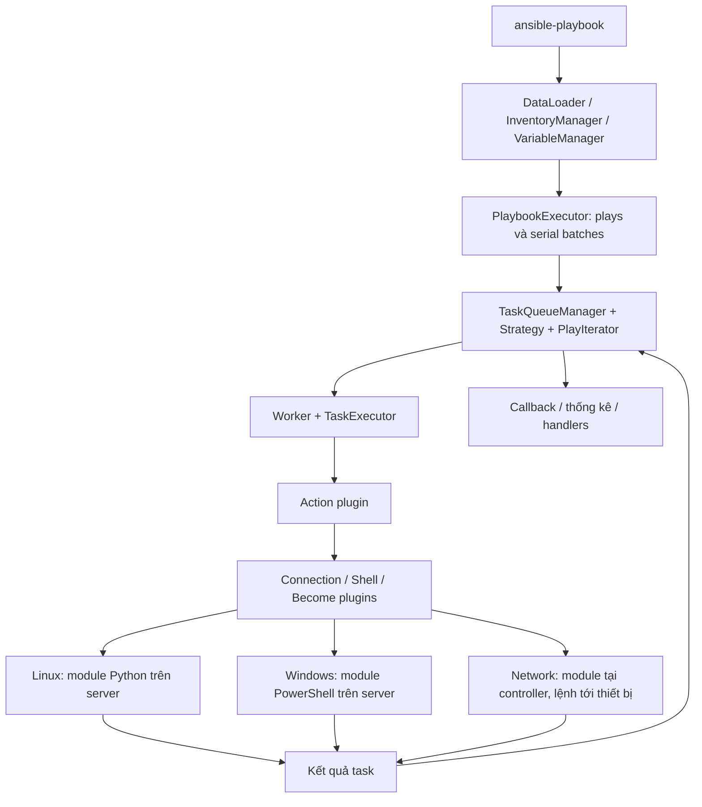
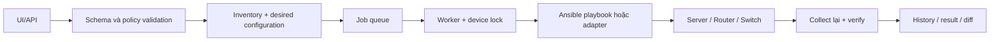

# Ansible: kiến trúc code và thuật toán cấu hình server, router, switch

Ngày hoàn thiện: 14/10/2026. Tài liệu kỹ thuật phục vụ nghiên cứu và thiết kế đồ án.

Phạm vi mã nguồn: `ansible-core 2.23.0.dev0`, commit `7769a0b59580f0448e8c399d6bde6cdbdca5375a`.
Tài liệu được biên soạn với sự hỗ trợ của Codex, đối chiếu mã nguồn trong repository này.
Các đoạn giả mã là diễn giải phục vụ học tập, không phải mã chép nguyên văn hoặc API công khai của Ansible.
Ví dụ là cấu hình phòng lab; chưa được chạy trên server hay thiết bị mạng thực tế.

## 1. Ansible giải quyết bài toán gì?

Đầu vào là danh sách đối tượng quản lý, thông tin kết nối, các biến và mô tả công việc cần thực hiện.
Ansible tổ chức việc chạy công việc trên nhiều đối tượng, gọi đúng module và thu kết quả về controller.
Với module quản lý trạng thái, module đọc hiện trạng, so sánh với yêu cầu rồi chỉ thực hiện thay đổi cần thiết.

Ví dụ: server cần một file cấu hình và dịch vụ đang chạy; switch cần VLAN 20; router cần địa chỉ IP trên interface.
Người dùng xác định trạng thái mong muốn. Ansible không tự suy ra thiết kế mạng tối ưu từ một mục tiêu kinh doanh.

Có ba ranh giới cần phân biệt:

| Thành phần | Trách nhiệm |
| --- | --- |
| ansible-core | Đọc playbook, biến, inventory; điều phối; nạp plugin; vận chuyển và nhận kết quả. |
| Module và collection | Hiểu loại tài nguyên, hệ điều hành, cú pháp cấu hình và cách tính thay đổi. |
| Thiết bị hoặc server | Thực hiện thao tác thông qua hệ điều hành, CLI hoặc API quản trị. |

Repository đang đọc là **ansible-core**.
Các module Cisco IOS và nhiều module Windows nằm trong collection bên ngoài, không phải toàn bộ đều có ở đây.
Bởi vậy, cơ chế điều phối bên dưới được đối chiếu trực tiếp với code; ví dụ mạng có thêm nguồn tài liệu chính thức.

## 2. Mô hình trạng thái và tính idempotent

Ký hiệu `S` là trạng thái hiện tại, `D` là trạng thái mong muốn và `F_D` là phép áp dụng yêu cầu `D`.
Một thao tác idempotent thỏa mãn:

```text
F_D(F_D(S)) = F_D(S)
```

Nghĩa là sau khi đã đạt yêu cầu, chạy lại cùng đầu vào không tạo thêm thay đổi trong phạm vi tài nguyên quản lý.
Điều này giả định đầu vào ổn định và không có tác nhân khác sửa cấu hình giữa hai lần chạy.

Giả mã khái niệm của một module quản lý trạng thái:

```python
def reconcile(adapter, desired, check_mode=False):
    actual = adapter.observe()
    current = adapter.normalize(actual)
    target = adapter.normalize(desired)
    operations = adapter.compare(current, target)
    if not operations:
        return {"changed": False}
    if check_mode:
        return {"changed": True, "planned": operations}
    adapter.apply(operations)
    return {"changed": True}
```

Đây không phải thuật toán chung mà core tự động áp cho mọi module.
Mỗi module quyết định quan sát gì, so sánh thế nào, có hỗ trợ check mode hay không và kiểm chứng đến mức nào.
Các module chạy lệnh tùy ý không tự nhiên trở thành idempotent.

`changed: false` chỉ nói module không báo thay đổi trong lần chạy đó.
Nó không chứng minh toàn hệ thống đúng, không chứng minh dịch vụ thông suốt, và không đảm bảo mọi cấu hình được quản lý.
`changed_when` có thể sửa cách báo cáo nhưng không làm thao tác bên dưới trở thành idempotent.

Ansible đánh giá và thực thi từng task trong ngữ cảnh đang tiến triển.
Nó không bắt buộc tạo một bản kế hoạch bất biến cho toàn bộ playbook trước khi bắt đầu ghi cấu hình.

## 3. Luồng thực thi tổng thể trong mã nguồn



Sơ đồ mô tả trách nhiệm logic; mỗi ô không nhất thiết tương ứng một tiến trình riêng.
`delegate_to` và kết nối `local` có thể thay đổi nơi thực thi cụ thể.

### 3.1. CLI, inventory và mô hình playbook

[CLI._play_prereqs](lib/ansible/cli/__init__.py) khởi tạo các thành phần tải dữ liệu, inventory và biến.
[InventoryManager](lib/ansible/inventory/manager.py) đọc nguồn inventory thông qua inventory plugin.
Một host có định danh, địa chỉ kết nối, nhóm và các biến; host pattern chọn tập host cho play.
Inventory có thể đến từ file hoặc plugin động, không bắt buộc là danh sách IP viết tay.

[DataLoader](lib/ansible/parsing/dataloader.py) đảm nhiệm việc đọc dữ liệu và hỗ trợ dữ liệu Vault.
Các cấu trúc trong [playbook](lib/ansible/playbook) biểu diễn Play, Block, Task, Role và Handler.
Static import được mở rộng trong quá trình nạp; dynamic include phụ thuộc ngữ cảnh lúc thực thi.
Vì vậy không thể xem mọi playbook là một danh sách task cố định được mở rộng hoàn toàn từ đầu.

### 3.2. Hợp nhất biến và xử lý template

[VariableManager.get_vars](lib/ansible/vars/manager.py) xây dựng ngữ cảnh biến cho play, host và task.
Các nguồn gồm role defaults, biến nhóm/host, facts, play vars, role/task vars, include vars, biến đăng ký và extra vars.
Thứ tự hợp nhất có ý nghĩa: nguồn ưu tiên cao ghi đè giá trị xung đột của nguồn ưu tiên thấp.
Một số bước còn phụ thuộc cấu hình thứ tự group vars và ngữ cảnh include/role.
Không nên rút gọn thành quy tắc "biến đọc sau trong YAML luôn thắng".

Ví dụ một role đặt `app_port: 8080`, còn host cụ thể đặt giá trị phù hợp môi trường.
Khi task render template, nó sử dụng ngữ cảnh biến cuối cùng của host đó, không dùng một bản chung cho toàn bộ host.

[TemplateEngine](lib/ansible/_internal/_templating/_engine.py) xử lý biểu thức và template Jinja.
Nhánh code này có đánh giá trì hoãn và thông tin về độ tin cậy của dữ liệu template.
Một giá trị lấy từ bên ngoài chứa dấu `{{ ... }}` không vì thế mặc nhiên được coi là mã template đáng tin cậy.
Khi tự viết đồ án, nên tách dữ liệu đầu vào khỏi biểu thức được phép thực thi.

### 3.3. Điều phối: serial, forks, strategy và throttle

[PlaybookExecutor._get_serialized_batches](lib/ansible/executor/playbook_executor.py) chia host theo `serial`.
`serial` có thể là số lượng, phần trăm hoặc danh sách kích thước batch; hết danh sách thì tiếp tục dùng phần tử cuối.
Phần trăm được tính theo tổng số host của play ở bước chia batch này.

[TaskQueueManager](lib/ansible/executor/task_queue_manager.py) quản lý worker, hàng đợi kết quả và strategy.
`forks` giới hạn mức song song của worker; `serial` giới hạn nhóm host tham gia một lượt triển khai.
`throttle` có thể siết mức đồng thời ở phạm vi task/block/play tương ứng, trong giới hạn của cơ chế điều phối.

| Strategy | Cách tiến triển |
| --- | --- |
| [linear](lib/ansible/plugins/strategy/linear.py) | Các host tiến theo từng bước task; host chậm có thể giữ các host khác tại bước đó. |
| [free](lib/ansible/plugins/strategy/free.py) | Host sẵn sàng có thể tiến tới task sau mà không đợi mọi host cùng bước. |
| [host_pinned](lib/ansible/plugins/strategy/host_pinned.py) | Ưu tiên giữ một host tiến triển hết play trong số slot đang hoạt động. |

Ví dụ 100 server, `serial: 10`, `forks: 5`: xử lý từng batch 10 host, tối đa khoảng 5 worker cùng lúc.
Không có nghĩa 100 server cùng thay đổi cấu hình tại một thời điểm.
`run_once` cũng cần đọc theo strategy và batch; với serial không nên hiểu là luôn chỉ một lần cho toàn bộ đợt triển khai.

### 3.4. Máy trạng thái của từng host

[PlayIterator](lib/ansible/executor/play_iterator.py) giữ trạng thái tiến triển của từng host qua các block và task.
Nhánh hiện tại có các trạng thái SETUP, VALIDATE, TASKS, RESCUE, ALWAYS, HANDLERS và COMPLETE.
SETUP liên quan đến thu thập facts; VALIDATE liên quan đến kiểm tra argument spec theo cấu hình của play.
Các trạng thái không phải danh sách luôn chạy tuần tự đầy đủ trong mọi play.

Khi task trong block thất bại, iterator có thể chuyển sang `rescue`, sau đó xử lý `always` theo ngữ nghĩa block.
`rescue` là luồng xử lý lỗi do người dùng viết; nó không tự đảo ngược mọi thay đổi đã thực hiện.
Lỗi không kết nối được và lỗi định nghĩa task cũng không đồng nhất với lỗi task thông thường có thể rescue.

### 3.5. TaskExecutor: điều kiện, vòng lặp, retry và kết quả

[TaskExecutor](lib/ansible/executor/task_executor.py) thực hiện công việc cho một host/task.
Luồng rút gọn gồm chuẩn bị delegation và ngữ cảnh, kiểm tra `when`, hoàn thiện tham số, chọn connection/action rồi thực thi.
Code kiểm tra điều kiện trước bước post-validation cuối cùng của task.
Điều này giúp task được bỏ qua không nhất thiết lỗi vì tham số chỉ cần thiết khi nó thực sự chạy.

`loop` tạo các lần thực hiện với biến item tương ứng.
`until`, `retries`, `delay` điều khiển các lần thử lại và đánh giá điều kiện trên kết quả.
`async` và `poll` điều khiển cách theo dõi công việc bất đồng bộ; khả năng hỗ trợ còn phụ thuộc action và connection.
Không nên retry mù một lệnh có tác dụng cộng dồn, chẳng hạn tạo thêm đối tượng không có khóa định danh ổn định.

Nhánh này sử dụng `TaskContext` và `UnifiedTaskResult`, không chỉ truyền một dictionary đơn giản khắp engine.
Strategy xử lý kết quả, cập nhật biến/facts, đăng ký kết quả, đếm trạng thái và quyết định host còn được chạy tiếp hay không.
`failed_when` và `changed_when` điều chỉnh cách diễn giải kết quả ở tầng task.

Handler được thông báo khi task báo thay đổi và có `notify` phù hợp.
Cơ chế thông báo có khử trùng lặp theo host; nhiều task cùng notify không bắt buộc khiến handler chạy nhiều lần trong cùng lượt flush.
Xem [StrategyBase](lib/ansible/plugins/strategy/__init__.py) và [Handler](lib/ansible/playbook/handler.py).

## 4. Ansible cấu hình Linux/Unix server như thế nào?

### 4.1. Tách Action plugin và Module

Action plugin chạy ở controller để chuẩn bị công việc; module thường chạy trên server đích.
[ActionBase._execute_module](lib/ansible/plugins/action/__init__.py) chuẩn bị và gọi module qua kết nối đã chọn.
[SSH connection](lib/ansible/plugins/connection/ssh.py) thực hiện vận chuyển và chạy lệnh qua SSH.
Shell plugin lo cú pháp shell/đường dẫn; become plugin lo nâng quyền, chẳng hạn sudo khi được cấu hình.

`template` minh họa rõ sự phân tách:

1. [Template action](lib/ansible/plugins/action/template.py) render template bằng biến trên controller.
2. Nội dung đã render được chuyển sang luồng copy.
3. [Copy action](lib/ansible/plugins/action/copy.py) kiểm tra nguồn/đích và chuẩn bị truyền dữ liệu khi cần.
4. [Copy module](lib/ansible/modules/copy.py) thực hiện cập nhật nội dung và thuộc tính file ở server.

Do đó không phải mọi phần của một task đều chạy trên máy đích.

### 4.2. Đóng gói module bằng AnsiballZ

[Module packaging](lib/ansible/executor/module_common.py) phân tích các phụ thuộc `module_utils` cần cho module Python.
Nó tạo payload chứa module và phần hỗ trợ cần thiết, thay vì yêu cầu cài toàn bộ controller lên server.
Wrapper AnsiballZ chịu trách nhiệm bootstrap và thực thi module cùng tham số đã tuần tự hóa.

Luồng khái niệm:

```text
module source + argument JSON + module_utils dependencies
    -> dependency discovery
    -> packaged payload / wrapper
    -> SSH transport
    -> Python interpreter on target
    -> module main()
    -> structured result back to controller
```

Tùy kết nối và tùy chọn, payload được gửi qua đường stdin khi hỗ trợ pipelining hoặc thông qua file tạm.
Việc chọn interpreter có thể dựa trên cấu hình `ansible_python_interpreter` hoặc cơ chế discovery.
"Agentless" ở đây nghĩa không cần một Ansible agent thường trú trên server, không có nghĩa server không cần môi trường thực thi.
Một số module đặc biệt như `raw` có luồng khác, hữu ích khi bootstrap máy chưa có Python.

### 4.3. Module xác thực tham số và trả kết quả

[AnsibleModule](lib/ansible/module_utils/basic.py) cung cấp xử lý tham số, check mode, thuộc tính file và kết quả JSON.
Module khai báo argument spec: kiểu dữ liệu, giá trị mặc định, lựa chọn, trường bắt buộc hoặc quan hệ giữa tham số.
Module thực hiện thao tác rồi gọi `exit_json`, hoặc trả lỗi có cấu trúc; wrapper hiện tại cũng có cơ chế xử lý exception chung.

Các trường thường gặp: `changed`, `failed`, `msg`, dữ liệu thu thập và thông tin diff khi hỗ trợ.
Dữ liệu stdout tùy ý không được làm hỏng giao thức kết quả module.
Controller cần phân biệt lỗi kết nối, lỗi chạy module và kết quả nghiệp vụ không đạt yêu cầu.

### 4.4. Thuật toán thực tế của copy

Trong [copy.py](lib/ansible/modules/copy.py), module tính SHA-1 nguồn và đích khi có thể rồi so sánh checksum.
Khác nội dung hoặc cần xử lý symlink thì đi vào nhánh thay đổi.
Nếu không phải check mode, module có thể backup, chạy lệnh validate và dùng `atomic_move` để đưa file vào đích.
Sau đó nó vẫn đối chiếu thuộc tính hệ thống file: nội dung giống nhau chưa đủ nếu mode, owner hoặc group sai.

Giả mã lược bỏ nhánh thư mục, symlink và nhiều chi tiết lỗi:

```python
def update_file(src, dest, desired_attrs, check_mode):
    content_changed = sha1(src) != sha1_if_exists(dest)
    attrs_changed = compare_attributes(dest, desired_attrs)
    if not check_mode:
        if content_changed:
            validate_candidate(src)
            atomic_replace(src, dest)
        apply_attributes(dest, desired_attrs)
    return {"changed": content_changed or attrs_changed}
```

Đọc toàn bộ B byte để tính hash có chi phí O(B).
Checksum ở đây giúp phát hiện khác biệt nội dung; không nên dùng nhận xét này như chứng minh an toàn mật mã của SHA-1.
`atomic_move` giúp giảm nguy cơ đọc thấy file ghi dở, nhưng không tạo transaction cho cả chuỗi nhiều task.
`unsafe_writes` là một lựa chọn khác với các bảo đảm của đường ghi nguyên tử thông thường.

### 4.5. Package, service và command

[Package action](lib/ansible/plugins/action/package.py) đóng vai trò điều phối tới package backend thích hợp.
Thuật toán đọc trạng thái và cài/gỡ cụ thể nằm ở module backend của package manager.

[systemd_service](lib/ansible/modules/systemd_service.py) đọc trạng thái dịch vụ rồi quyết định hành động.
`state: started` yêu cầu dịch vụ đang chạy; nếu đã chạy thì không nhất thiết khởi động lại.
`state: restarted` yêu cầu một hành động restart, nên không có ngữ nghĩa giống `started`.

[command](lib/ansible/modules/command.py) chạy lệnh và thường báo thay đổi khi thực thi.
`creates` hoặc `removes` cung cấp điều kiện dựa trên file để bỏ qua lệnh trong một số trường hợp.
Đó là điều kiện do người viết xác định, không phải Ansible phân tích mọi lệnh shell và tự hiểu tác dụng của chúng.

### 4.6. Ví dụ Linux có thể dùng làm bài thực nghiệm

Playbook dưới đây giả định máy Linux có systemd, có quyền become và truy cập được kho package chứa nginx.
Nó dùng file HTML đơn giản để không phụ thuộc cấu trúc file cấu hình nginx giữa các bản phân phối.
Đường dẫn web root phải được chỉnh theo bản phân phối của lab.

```yaml
- name: Configure Linux web servers
  hosts: linux_servers
  become: true
  serial: 2
  vars:
    web_root: /var/www/html
  tasks:
    - name: Ensure nginx package exists
      ansible.builtin.package:
        name: nginx
        state: present
    - name: Ensure web directory exists
      ansible.builtin.file:
        path: "{{ web_root }}"
        state: directory
        mode: '0755'
    - name: Deploy a stable home page
      ansible.builtin.copy:
        content: "Managed server: {{ inventory_hostname }}\n"
        dest: "{{ web_root }}/index.html"
        mode: '0644'
    - name: Ensure service is enabled and running
      ansible.builtin.systemd_service:
        name: nginx
        enabled: true
        state: started
```

Lần chạy đầu có thể cài package, tạo thư mục/file và bật service.
Lần hai với cùng trạng thái đầu vào dự kiến không thay đổi các tài nguyên trên.
Nếu sửa nội dung file thủ công rồi chạy lại, copy đưa nội dung trong phạm vi quản lý về yêu cầu.
Muốn chứng minh ứng dụng hoạt động, cần thêm kiểm tra HTTP; trạng thái service chạy chưa đủ.

## 5. Ansible cấu hình Windows server như thế nào?

Engine playbook và điều phối vẫn là phần dùng chung.
Nhánh Windows thường sử dụng [winrm](lib/ansible/plugins/connection/winrm.py)
hoặc [psrp](lib/ansible/plugins/connection/psrp.py) cùng shell PowerShell.
Module chức năng thường thuộc collection `ansible.windows`; không nên lấy module Linux rồi giả định chạy được trên Windows.

[Module manifest](lib/ansible/executor/powershell/module_manifest.py) chuẩn bị payload và các phụ thuộc PowerShell/C#.
Các wrapper trong [executor/powershell](lib/ansible/executor/powershell) bootstrap, nạp phần hỗ trợ và chạy module.
Đường này khác payload Python AnsiballZ trên Linux.

```text
Task + Windows action/module
    -> PowerShell payload and dependency manifest
    -> WinRM or PSRP transport
    -> PowerShell runtime on Windows
    -> Windows API / service / filesystem operations
    -> structured result
```

Một module quản lý service Windows cần đọc trạng thái qua cơ chế Windows rồi quyết định start/stop hoặc sửa startup mode.
Ý tưởng đối chiếu trạng thái giống Linux, nhưng API và cấu trúc dữ liệu không giống systemd.
Trong đồ án, nên dùng cùng mô hình kết quả nhưng tách adapter theo nền tảng.

Ví dụ ý tưởng đầu vào, không phải tên tham số của một API Ansible mới:

```yaml
resource:
  kind: service
  platform: windows
  identity: W32Time
  desired:
    running: true
    startup: automatic
```

Phần frontend có thể thống nhất biểu mẫu, còn adapter chịu trách nhiệm ánh xạ sang module cụ thể và kiểm tra capability.
Không nên ép mọi dịch vụ Linux và Windows có tập tính năng hoàn toàn giống nhau.

## 6. Ansible cấu hình router và switch như thế nào?

### 6.1. Điểm khác lớn nhất: module thường chạy tại controller

[NetworkConnectionBase](lib/ansible/plugins/connection/__init__.py) đặt `force_persistence = True`
và `_remote_is_local = True`; `exec_command` của lớp này chuyển sang local connection.
[TaskExecutor](lib/ansible/executor/task_executor.py) cũng có xử lý interpreter khi dùng `ansible_network_os` trong ngữ cảnh này.

Điều đó phục vụ mô hình module mạng chạy bằng Python tại controller và gửi thao tác quản trị tới thiết bị.
Không cần chép Python module lên Cisco switch rồi đòi switch chạy như Linux server.
Các trường hợp thiết bị hoặc collection đặc thù vẫn phải đọc tài liệu của chúng.

```text
Python network module on controller
    -> internal JSON-RPC over Unix socket
    -> persistent connection process
    -> SSH CLI / NETCONF / HTTP API
    -> router or switch
```

[Connection helper](lib/ansible/module_utils/connection.py) cung cấp giao tiếp nội bộ qua Unix socket.
[Persistent connection CLI](lib/ansible/cli/scripts/ansible_connection_cli_stub.py) phục vụ tiến trình kết nối.
JSON-RPC trong luồng này là IPC giữa các thành phần ở controller, không mặc nhiên là giao thức thiết bị nhận qua mạng.

Kết nối lâu dài giúp tránh đăng nhập lại sau mỗi task.
Tuy nhiên, giữ kết nối không loại bỏ timeout, mất phiên, đổi prompt, lỗi quyền hoặc thay đổi cấu hình từ người khác.

### 6.2. Plugin kết nối và khác biệt giữa các hãng

[Plugin routing](lib/ansible/config/ansible_builtin_runtime.yml) chứa ánh xạ tới collection như `ansible.netcommon` và `cisco.ios`.
Core có khung plugin nhưng không chứa đầy đủ triển khai CLI cho mọi hệ điều hành mạng.

| Kênh | Đặc điểm xử lý |
| --- | --- |
| network_cli | Phiên CLI qua SSH; cần xử lý prompt, mode cấu hình, phân trang và lỗi theo nền tảng. |
| netconf | RPC và cấu hình có cấu trúc; thao tác datastore tùy capability của thiết bị. |
| httpapi | Gửi yêu cầu API qua HTTP(S); endpoint, xác thực và payload phụ thuộc nền tảng. |

`ansible_network_os` giúp chọn phần hỗ trợ đúng nền tảng.
Các lớp terminal/cliconf giải quyết khác biệt ở CLI; không nên ghép tất cả thành một hàm chỉ gửi chuỗi qua SSH.
Khung [NetconfBase](lib/ansible/plugins/netconf/__init__.py) biểu diễn các thao tác như get/edit/commit/lock.
Có tên phương thức trong framework không đồng nghĩa mọi thiết bị đều có candidate datastore hay confirmed commit.

### 6.3. Hai cách biểu diễn cấu hình

Cách thứ nhất quản lý các dòng cấu hình, ví dụ `ios_config`.
`match: line` so sự có mặt của dòng; `strict` xét vị trí; `exact` yêu cầu khớp phần cấu hình chính xác; `none` bỏ so khớp.
Cú pháp viết tắt, indentation và giá trị mặc định có thể ảnh hưởng kết quả.
Backup lưu bản trước thay đổi; `save_when` điều khiển việc lưu cấu hình.
Xem [tài liệu ios_config](https://docs.ansible.com/projects/ansible/latest/collections/cisco/ios/ios_config_module.html).

Cách thứ hai dùng resource module với dữ liệu có cấu trúc.
`merged` hợp nhất; `replaced` thay phần tài nguyên được chỉ định; `overridden` quản lý rộng hơn toàn tập tài nguyên của module.
`deleted` xóa cấu hình trong phạm vi hỗ trợ; `gathered` thu thập; `rendered` sinh cấu hình offline; `parsed` phân tích chuỗi offline.
Không phải module nào cũng hỗ trợ đủ mọi state.
Xem [resource module states](https://docs.ansible.com/projects/ansible/latest/network/user_guide/network_resource_modules.html).

### 6.4. Thuật toán đối chiếu tài nguyên: cách diễn giải để áp dụng vào đồ án

Phần này là mô hình thiết kế rút ra từ cách quản lý trạng thái, không khẳng định mọi collection dùng cùng một hàm diff.
Giả sử switch đang có VLAN 10 tên STAFF và VLAN 20 tên OLD; yêu cầu VLAN 20 tên STUDENT và VLAN 30 tên LAB.
Với phạm vi hợp nhất, kết quả mong đợi giữ VLAN 10, đổi tên VLAN 20, thêm VLAN 30.

Nên chuyển danh sách thành bảng theo khóa định danh:

```python
current = {10: {"name": "STAFF"}, 20: {"name": "OLD"}}
desired = {20: {"name": "STUDENT"}, 30: {"name": "LAB"}}
operations = []
for vlan_id, wanted in desired.items():
    observed = current.get(vlan_id)
    if observed is None:
        operations.append(("create_vlan", vlan_id, wanted))
    elif observed.get("name") != wanted.get("name"):
        operations.append(("set_vlan_name", vlan_id, wanted["name"]))
```

Bước renderer của adapter mới chuyển operation thành lệnh của hãng.
Không sinh lệnh xóa VLAN 10 trong thuật toán hợp nhất này vì nó nằm ngoài đầu vào cần sửa.
Nếu xây chế độ thay toàn bộ tập tài nguyên, cần tính thêm tập xóa và bảo vệ các tài nguyên mặc định hoặc quản trị.

Chuẩn hóa cần xử lý tên interface, dạng địa chỉ, giá trị mặc định và các trường được thiết bị tự bổ sung.
So sánh nguyên chuỗi dễ tạo thay đổi giả nếu thiết bị chuẩn hóa cú pháp sau khi nhận lệnh.
Với ACL có thứ tự, không thể dùng phép hiệu hai tập hợp rồi bỏ thứ tự rule.

### 6.5. Ví dụ switch: tạo VLAN không đồng nghĩa gán cổng

Đây là ví dụ phòng lab IOS; cần collection tương ứng và switch hỗ trợ VLAN.
Các module quản lý VLAN và interface là các tài nguyên khác nhau.
Tạo VLAN 20 chưa khiến cổng access tự chuyển vào VLAN 20, cũng chưa tạo SVI hoặc routing giữa VLAN.

```yaml
- name: Configure lab switch VLANs
  hosts: ios_switches
  gather_facts: false
  tasks:
    - name: Merge required VLANs
      cisco.ios.ios_vlans:
        config:
          - vlan_id: 20
            name: STUDENT
          - vlan_id: 30
            name: LAB
        state: merged
```

Đối chiếu schema với phiên bản collection được cài và
[ví dụ quản lý VLAN chính thức](https://docs.ansible.com/projects/ansible/latest/network/user_guide/network_resource_modules.html).

Một use case đầy đủ cho đồ án nên tách: tạo VLAN, cấu hình access/trunk, thu thập lại membership, rồi thử kết nối trong lab.
Điều kiện kiểm chứng phải phản ánh mục tiêu mạng, không chỉ kiểm tra tác vụ tạo VLAN trả thành công.

### 6.6. Ví dụ router: địa chỉ trên interface lớp 3

Module `ios_l3_interfaces` nhận cấu hình địa chỉ có cấu trúc; ví dụ dưới dùng mạng dành cho tài liệu.
Interface phải tồn tại và hỗ trợ lớp 3; việc bật interface có thể cần task quản lý interface riêng.
Xem [schema ios_l3_interfaces](https://docs.ansible.com/projects/ansible/latest/collections/cisco/ios/ios_l3_interfaces_module.html).

```yaml
- name: Configure lab router addressing
  hosts: ios_routers
  gather_facts: false
  tasks:
    - name: Merge IPv4 address
      cisco.ios.ios_l3_interfaces:
        config:
          - name: GigabitEthernet0/1
            ipv4:
              - address: 192.0.2.1/24
        state: merged
```

Thuật toán của đồ án cần phân biệt cấu hình địa chỉ, trạng thái admin, trạng thái link và khả năng chuyển tiếp gói.
Cổng có IP đúng nhưng cáp chưa nối vẫn có thể operational down.
Static route có trong cấu hình cũng chưa đảm bảo next hop có thể tới được hoặc route đang được cài vào bảng chuyển tiếp.

### 6.7. Inventory dùng chung cho các ví dụ

```yaml
all:
  children:
    linux_servers:
      hosts:
        web01:
          ansible_host: 192.0.2.10
      vars:
        ansible_user: automation
    ios_devices:
      vars:
        ansible_connection: ansible.netcommon.network_cli
        ansible_network_os: cisco.ios.ios
        ansible_user: automation
      children:
        ios_switches:
          hosts:
            sw01:
              ansible_host: 192.0.2.20
        ios_routers:
          hosts:
            r01:
              ansible_host: 192.0.2.30
```

Địa chỉ trên chỉ là ví dụ, cần thay bằng địa chỉ quản trị của lab.
Thông tin bí mật được cấp qua cơ chế phù hợp của môi trường, không nhúng mật khẩu vào tài liệu.
Thiết bị yêu cầu enable mode cần thêm cấu hình nâng quyền thích hợp cho kết nối mạng.

## 7. Check mode, diff, backup và rollback khác nhau ra sao?

| Cơ chế | Ý nghĩa và giới hạn |
| --- | --- |
| Check mode | Dự đoán thay đổi nếu module hỗ trợ; không mô phỏng đầy đủ mọi tác động của cả playbook. |
| Diff | Hiển thị khác biệt nếu module hỗ trợ; có thể chứa dữ liệu nhạy cảm. |
| Backup | Giữ bản dữ liệu trước thay đổi; chưa có nghĩa tự phục hồi được cả hệ thống. |
| Rescue | Chạy nhánh xử lý lỗi do tác giả playbook định nghĩa. |
| Rollback | Cần hành động phục hồi cụ thể hoặc cơ chế transaction mà nền tảng thực sự hỗ trợ. |

Ví dụ một task tạo file rồi task kế tiếp thất bại: core không tự xóa file để khôi phục trạng thái ban đầu.
Tương tự, 5 switch cấu hình xong và switch thứ 6 mất kết nối không khiến 5 switch đầu tự trở về cấu hình cũ.

Cấu hình chạy và cấu hình dùng sau reboot cũng cần phân biệt.
Đồ án phải định nghĩa khi nào lưu bền vững và xác nhận việc lưu đã thành công, thay vì coi gửi lệnh thành công là đủ.
Không có bảo đảm transaction phân tán mặc định cho một playbook chạy nhiều thiết bị.

## 8. Chi phí thuật toán và hiệu năng

Các ước lượng dưới đây là phân tích thiết kế, không phải bảo đảm độ phức tạp của mọi module Ansible.

- Hash một file B byte tốn O(B) thời gian đọc dữ liệu.
- Đối chiếu n tài nguyên hiện tại và m tài nguyên mong muốn bằng bảng băm có thể đạt O(n + m) kỳ vọng.
- Duyệt lồng từng tài nguyên mong muốn với mọi tài nguyên hiện tại có thể tốn O(n * m).
- Gửi k yêu cầu tuần tự chịu chi phí xấp xỉ k lần RTT cộng thời gian thiết bị xử lý.
- Giữ kết nối giảm chi phí thiết lập phiên; không xóa chi phí các lệnh đọc và ghi cấu hình.

Với B host trong một batch, P worker và một task có thời gian gần đều t:

```text
T_task ≈ ceil(B / P) * t + chi_phi_dieu_phoi
```

Đây là mô hình đơn giản; host chậm, retry, throttle, strategy, I/O và thời gian đăng nhập làm kết quả thay đổi.
Tăng forks quá nhiều có thể gây nghẽn controller, AAA server hoặc giới hạn phiên quản trị trên thiết bị.
Nên đo throughput và tỷ lệ lỗi theo từng mức song song, thay vì mặc định càng nhiều worker càng tốt.

## 9. Lỗi, bí mật và kiểm chứng kết quả

Có ba mức thành công khác nhau:

1. Kênh vận chuyển nhận được phản hồi hợp lệ.
2. Cấu hình đọc lại khớp trạng thái mong muốn trong phạm vi quản lý.
3. Dịch vụ hoặc luồng lưu lượng thực tế đáp ứng mục tiêu.

Một pipeline đáng tin cậy cần chỉ rõ nó đã xác nhận mức nào.
Module báo thành công chưa tự động chứng minh HTTP, ping, forwarding hoặc giao thức định tuyến hoạt động đúng.

Nếu mất kết nối ngay sau khi gửi lệnh ghi, kết quả có thể là "không biết đã áp dụng hay chưa".
Retry ngay một thao tác không idempotent có thể tạo tác dụng phụ lần hai.
Hướng xử lý là kết nối lại, thu thập hiện trạng và tính lại thay đổi trước khi tiếp tục khi khả thi.

Vault bảo vệ dữ liệu được mã hóa khi lưu; không thay thế SSH/TLS và không tự ngăn mọi cách rò rỉ qua log.
`no_log` và tham số được đánh dấu bí mật hỗ trợ che dữ liệu; ứng dụng bao ngoài vẫn phải kiểm soát log, diff và bản backup.
Xem [Vault](lib/ansible/parsing/vault) và [Display](lib/ansible/utils/display.py).

Khi nhiều job có thể sửa cùng thiết bị, nên khóa theo thiết bị hoặc tài nguyên ở tầng ứng dụng.
Persistent connection của Ansible không phải một khóa chống mọi người dùng hoặc hệ thống khác sửa thiết bị.

## 10. Cách đưa kiến trúc này vào đồ án

Phần này là thiết kế đề xuất, không phải tính năng đã có sẵn trong repository.



### 10.1. Mô hình dữ liệu tối thiểu

| Đối tượng | Các trường chính |
| --- | --- |
| Device | ID, platform, địa chỉ quản trị, connection profile, tham chiếu credential. |
| DesiredConfig | Device ID, loại tài nguyên, khóa tài nguyên, cấu hình mong muốn, phiên bản. |
| Job | ID, người yêu cầu, thời điểm, tập thiết bị, chế độ preview/apply, trạng thái. |
| DeviceResult | Before, operations, after, lỗi, trạng thái kiểm chứng, thời gian. |

Khóa tài nguyên cần có ý nghĩa nghiệp vụ: VLAN ID, tên interface chuẩn hóa, đường dẫn file, tên service.
Với route, khóa có thể phải bao gồm VRF, address family và prefix, không chỉ mỗi địa chỉ mạng.
Không lưu mật khẩu cùng bản cấu hình hoặc output có thể đọc rộng rãi.

### 10.2. Giao diện adapter nếu tự viết engine

```python
class ResourceAdapter:
    def capabilities(self): ...
    def collect(self): ...
    def normalize(self, data): ...
    def plan(self, current, desired, scope): ...
    def apply(self, operations): ...
    def verify(self, desired): ...
```

Đây là giao diện khái niệm cho đồ án.
`plan` trả operation có cấu trúc và phạm vi rõ ràng; adapter của hãng mới render thành lệnh hoặc API request.
Không nên để frontend tự ghép chuỗi lệnh quản trị từ đầu vào tùy ý.
`verify` tách kiểm tra cấu hình khỏi kiểm tra hoạt động nếu hai loại kiểm tra có chi phí hoặc quyền khác nhau.

### 10.3. Nếu dùng Ansible làm execution engine

Ứng dụng có thể tạo inventory và biến đã kiểm tra, chọn playbook được quản lý phiên bản, rồi gọi CLI trong worker.
Nên cố định phiên bản core và collection cho môi trường chạy để kết quả có thể tái hiện.
Cần thu exit status, kết quả theo host/task và thông tin kiểm chứng; không chỉ hiển thị stdout cuối cùng.
Các lớp Python nội bộ trong tài liệu dùng để học kiến trúc, không phải cam kết API ổn định cho ứng dụng tích hợp.

Trong báo cáo, tách đóng góp của đồ án: quản lý inventory, kiểm tra policy, biểu mẫu, lưu lịch sử, kiểm chứng và điều phối job.
Phần thực thi playbook/module được tái sử dụng từ Ansible cần ghi nguồn và phạm vi rõ ràng.

### 10.4. Các bài thực nghiệm phù hợp

| Đối tượng | Thao tác | Kiểm chứng |
| --- | --- | --- |
| Linux | File, package, service. | Nội dung/mode đúng, service chạy, HTTP phản hồi. |
| Windows | File và service theo module tương ứng. | Nội dung đúng, trạng thái service và phép thử ứng dụng. |
| Switch | VLAN và membership cổng. | Thu thập lại VLAN/cổng, thử kết nối lớp 2 trong lab. |
| Router | IP interface và route tĩnh. | Địa chỉ, trạng thái link, route hoạt động và khả năng tới đích. |

Có thể giữ phạm vi ít tài nguyên nhưng làm đầy đủ vòng collect, compare, apply, verify và lưu kết quả.
Đó là bằng chứng kỹ thuật rõ hơn một giao diện có nhiều nút nhưng chỉ gửi lệnh rồi báo thành công.

## 11. Kịch bản kiểm thử để chứng minh đồ án

| Kịch bản | Kết quả cần quan sát |
| --- | --- |
| Chạy lần đầu | Tạo đúng tài nguyên thiếu; ghi nhận before/after. |
| Chạy lần hai | Không thay đổi khi đã đạt trạng thái yêu cầu. |
| Sửa cấu hình thủ công | Phát hiện drift và sửa đúng phạm vi quản lý. |
| Có tài nguyên ngoài phạm vi | Giữ nguyên trong chế độ hợp nhất. |
| Đầu vào sai | Từ chối trước thao tác ghi khi lỗi có thể kiểm tra trước. |
| Check mode | Không ghi cấu hình với các module được hỗ trợ; mô tả hạn chế. |
| Mất kết nối sau thao tác ghi | Phân biệt thất bại chắc chắn với kết quả chưa xác định. |
| Một host lỗi giữa batch | Có kết quả riêng từng host và trạng thái tổng hợp trung thực. |
| Hai job cùng thiết bị | Có chính sách khóa hoặc phát hiện xung đột. |
| Reboot trong lab | Cấu hình đã lưu tồn tại đúng theo mục tiêu. |

Đo thời gian tổng, số yêu cầu tới thiết bị, số tài nguyên thay đổi, tỷ lệ lỗi và tỷ lệ kiểm chứng đạt.
Bài kiểm tra idempotency nên đối chiếu cả trạng thái thực tế và kết quả module, không chỉ đếm chữ `changed` trong console.

## 12. Lộ trình đọc code để tự nghiên cứu tiếp

1. [CLI prerequisites](lib/ansible/cli/__init__.py): khởi tạo loader, inventory và variable manager.
2. [PlaybookExecutor](lib/ansible/executor/playbook_executor.py): chạy play và chia batch.
3. [TaskQueueManager](lib/ansible/executor/task_queue_manager.py): worker và cơ chế điều phối.
4. [PlayIterator](lib/ansible/executor/play_iterator.py): trạng thái từng host và block.
5. [Strategy](lib/ansible/plugins/strategy): lựa chọn task được chạy tiếp và xử lý kết quả.
6. [TaskExecutor](lib/ansible/executor/task_executor.py): điều kiện, loop, connection, action và retry.
7. [ActionBase](lib/ansible/plugins/action/__init__.py): chuẩn bị và thực thi module.
8. [Module packaging](lib/ansible/executor/module_common.py): đóng gói Python và phụ thuộc.
9. [Copy module](lib/ansible/modules/copy.py): một ví dụ cụ thể về đối chiếu và cập nhật trạng thái.
10. [Network IPC](lib/ansible/module_utils/connection.py): giao tiếp module với tiến trình kết nối mạng.

Đối với mạng, tiếp tục đọc implementation của đúng collection và phiên bản được dùng trong lab.
Các trang tài liệu có đường dẫn `latest` có thể thay đổi; khi trích vào đồ án nên ghi phiên bản và ngày truy cập.
Các liên kết code trong tài liệu trỏ tới checkout hiện tại; hành vi nội bộ có thể khác ở phiên bản Ansible khác.

## 13. Trạng thái kiểm tra tài liệu

Đã kiểm tra các liên kết tới file/thư mục mã nguồn, độ dài dòng và khoảng trắng cuối dòng.
Năm khối YAML đã được parse; bốn khối Python minh họa đã được kiểm tra cú pháp bằng AST.
Các kiểm tra này không xác nhận module collection đã được cài hoặc ví dụ chạy thành công trên thiết bị.
Hai sanity test `line-endings` và `no-smart-quotes` đã được gọi nhưng bị skip do thiếu hỗ trợ virtual environment.
Không triển khai playbook lên hệ thống thực tế trong quá trình viết tài liệu.
