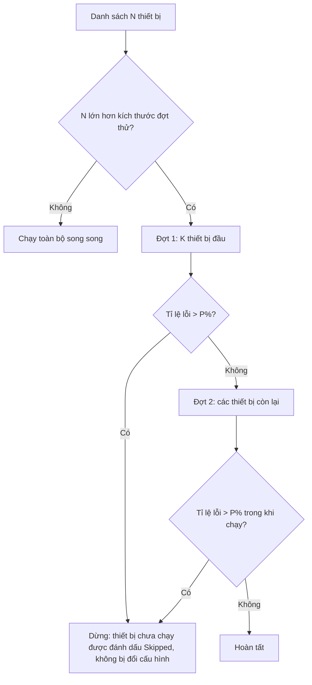

# BÁO CÁO KỸ THUẬT: CẢI TIẾN TỰ ĐỘNG HÓA CẤU HÌNH HÀNG LOẠT TRONG CAMS

**Hệ thống:** CAMS (Cisco Automation & Management System)  
**Nhánh:** `feature/cai-tien-tu-dong-hoa`  
**Thời gian thực hiện:** 14/10/2026  
**Chủ đề:** Rút ngắn thời gian và số thao tác khi cấu hình đồng thời số lượng lớn thiết bị (50–300 máy): chạy song song có kiểm soát, triển khai theo đợt, chọn thiết bị và tham số hàng loạt.

---

## 1. Bối cảnh và mục tiêu

Yêu cầu đặt ra: khi số thiết bị tăng lên khoảng 300, việc cấu hình phải nhanh và không phụ thuộc vào việc người dùng bấm, nhập tay cho từng thiết bị.

Hiện trạng trước khi cải tiến:

| Vấn đề | Biểu hiện |
| --- | --- |
| Song song thấp | View & Push hàng loạt bị giới hạn cứng 5 thiết bị cùng lúc (`core/view_push_batch.py`), các nơi khác tự đặt số riêng. |
| Không có cơ chế an toàn khi đẩy diện rộng | Nếu cấu hình sai, lỗi lan ra toàn bộ thiết bị trong lô; không có đợt thử, không có ngưỡng dừng. |
| Giới hạn nhóm 5 thiết bị | Routing Group, FHRP, VTP Group và menu Syslog Group chỉ cho tối đa 5 máy. |
| Chọn thiết bị thủ công | Muốn chọn 50 máy phải tick 50 ô; không chọn được theo subnet, dải IP, loại thiết bị hay tên. |
| Nhập tham số lặp lại | Process ID, source interface, VTP mode, FHRP priority, OSPF network/area phải nhập riêng cho từng máy. |

Ý tưởng tham chiếu từ tài liệu `docs/plan/ANSIBLE_KIEN_TRUC_VA_THUAT_TOAN.md`:

- `forks` của Ansible → số thiết bị chạy song song.
- `serial` + `max_fail_percentage` → đợt thử (canary) và ngưỡng dừng khi lỗi.
- Host pattern / group của inventory → bộ chọn thiết bị theo mẫu.

CAMS không nhúng Ansible; các ý tưởng trên được cài trực tiếp vào lớp thực thi Python và giao diện QML hiện có.

---

## 2. Phần A: Thực thi hàng loạt có kiểm soát

### 2.1. Tăng mức song song, cấu hình một chỗ

File: `infrastructure/network/batch_executor.py`

| Thông số | Trước | Sau |
| --- | --- | --- |
| Số thiết bị chạy cùng lúc mặc định | 5 | 20 |
| Giới hạn cứng | 20 (executor) và 5 (View & Push) | 50 |
| Nơi cấu hình | Rải rác ở 4 file | Một hằng số dùng chung, ghi đè được bằng biến môi trường hoặc trang Settings |

Các nơi trước đây tự đặt `max_concurrent_hosts=5` (`core/terminal.py`, `core/database/view_push_runtime.py`, `features/devices/batch_service.py`, `core/view_push_batch.py`) nay dùng chung giá trị mặc định.

Ước lượng theo mô hình `T ≈ ceil(N / P) × t`: với N = 300 thiết bị, t ≈ 30 giây/thiết bị:

- P = 5 → khoảng 30 phút.
- P = 20 → khoảng 7,5 phút.

Đây là ước lượng lý thuyết; thời gian thực phụ thuộc thiết bị, mạng và giới hạn phiên SSH (VTY).

### 2.2. Triển khai theo đợt (canary) và ngưỡng dừng

- Đợt thử mặc định: 5 thiết bị. Ngưỡng lỗi mặc định: 30%.
- Ngưỡng chỉ được xét sau khi đủ số mẫu bằng kích thước đợt thử, tránh việc một lỗi đầu tiên làm dừng cả lô.
- Thiết bị bị bỏ qua có trạng thái `cancelled` và cờ `halted`, kèm thông báo `Skipped …: failure rate exceeded P%, batch stopped.`
- Bước đồng bộ sau Push (lưu cấu hình, backup, sync) **không** bị dừng theo ngưỡng, để các thiết bị đã đẩy thành công vẫn được lưu cấu hình.

### 2.3. Trang cấu hình Settings → Batch Push

File mới: `UI/qml/content/BatchPushSettings.qml`

| Ô | Ý nghĩa | Khoảng giá trị |
| --- | --- | --- |
| Devices in parallel | Số thiết bị cấu hình cùng lúc | 1–50 |
| Test wave size | Số thiết bị chạy thử trước; 0 = tắt | 0–50 |
| Stop above failure (%) | Ngưỡng tỉ lệ lỗi để dừng; 100 = không dừng | 0–100 |

- Giá trị được lưu bằng `QSettings` (khóa `Batch/maxConcurrentHosts`, `Batch/canaryHosts`, `Batch/maxFailPercent`) và tự nạp khi khởi động (`core/database/view_push_runtime.py`).
- Backend mở 2 slot cho QML: `batchPushPolicy()` và `setBatchPushPolicy()` (`core/database/view_push_slots.py`).
- Biến môi trường `CAMS_MAX_CONCURRENT_HOSTS`, `CAMS_CANARY_HOSTS`, `CAMS_MAX_FAIL_PERCENT` vẫn dùng được làm giá trị mặc định khi chưa lưu Settings.

### 2.4. Hiển thị tiến trình trong hộp thoại View & Push

File: `UI/qml/shared/MultiHostViewPushDialog.qml`

- Trạng thái theo đợt: `Wave 1/2 (test wave): 1/5 devices done…`, `Wave 1/2 finished (5 ok, 0 failed). Wave 2/2: …`
- Đồng hồ thời gian chạy cạnh thanh tiến trình.
- Thông báo tổng kết tách riêng số máy thành công, lỗi và bị bỏ qua, kèm thời gian và lý do dừng.

---

## 3. Phần B: Chọn thiết bị hàng loạt

### 3.1. Bộ phân tích mẫu `HostPattern`

File mới: `UI/qml/shared/HostPattern.qml` (singleton QML)

| Mẫu | Ý nghĩa |
| --- | --- |
| `all`, `*` | Tất cả thiết bị |
| `192.168.1.10` | Một địa chỉ |
| `192.168.1.0/24` | Một subnet |
| `192.168.1.10-50`, `10.0.0.1-10.0.0.9` | Dải IP |
| `R1-R10`, `SW1-20`, `SW-1-5` | Dải theo số thứ tự trong tên |
| `router`, `switch`, `l2`, `l3` | Theo loại thiết bị (role) |
| `SW*`, `core-?` | Wildcard theo tên hoặc địa chỉ, không phân biệt hoa thường |
| `!mẫu` | Loại trừ; biểu thức chỉ có loại trừ thì bắt đầu từ toàn bộ thiết bị |

Mẫu sai (ví dụ `300.1.1.1`, `/40`, `R9-R2`) được báo lỗi và không làm thay đổi lựa chọn hiện tại.

### 3.2. Thanh chọn `HostSelectionBar`

File mới: `UI/qml/shared/HostSelectionBar.qml`

- Ô nhập mẫu + nút **Select** (chọn đúng các máy khớp) và **Exclude** (bỏ các máy khớp khỏi lựa chọn hiện tại; nếu chưa chọn gì thì giữ lại mọi máy khác). Exclude không cần gõ dấu `!`.
- Nút nhanh: **All**, **None**, **Routers**, **Switches**, **Invert**.
- Dòng phản hồi số thiết bị được chọn hoặc lỗi cú pháp.
- Hàng nút tự xuống dòng khi không đủ chỗ, dùng được cả ở sidebar hẹp.

Thanh chọn được gắn vào:

| Màn hình | File |
| --- | --- |
| Danh sách thiết bị bên trái (chế độ Select multiple) | `UI/qml/panels/DevicesPanel.qml` |
| Routing Group (OSPF/EIGRP), bước Hosts | `UI/qml/features/routing/RoutingGroupDialog.qml` |
| Syslog Group, bước Hosts | `UI/qml/features/syslog/SyslogGroupDialog.qml` |
| VTP Group | `UI/qml/features/switching/switching/VtpPage.qml` |
| FHRP (HSRP/VRRP/GLBP) | `UI/qml/features/fhrp/FhrpProtocolPage.qml` |

Để chọn theo loại thiết bị, backend bổ sung trường `role` vào danh sách host của FHRP (`features/fhrp/repository.py`), VTP (`features/switching/vtp_group.py`) và Routing Group (`features/routing/group_repository.py`).

### 3.3. Nâng giới hạn số thiết bị trong một nhóm

Giới hạn cũ 5 thiết bị được thay bằng **số thiết bị đủ điều kiện hiện có** (tối thiểu 2), áp dụng ở cả backend và giao diện:

| Nhóm | Backend | Giao diện |
| --- | --- | --- |
| Routing Group | `RoutingGroupService.max_hosts()` | `maxHosts` theo số host trong danh sách |
| FHRP | `FhrpService.max_hosts()` | `maxHosts` theo số host lựa chọn |
| VTP Group | `VtpGroupService.max_hosts()` bỏ trần 5 | Văn bản hướng dẫn cập nhật |
| Syslog Group | Đã theo số host từ trước | Bỏ điều kiện `<= 5` ở menu chuột phải sidebar |

---

## 4. Phần C: Nhập tham số hàng loạt trong các nhóm

| Nhóm | Vị trí | Thao tác hàng loạt |
| --- | --- | --- |
| Routing Group | Bước 2. Identity | Một Process ID (OSPF) hoặc AS (EIGRP) cho mọi host đã chọn. |
| Routing Group | Bước 4. Networks | Chọn/loại network theo mẫu (subnet, dải, tên interface như `Loopback*`, `Gi*0/1.*`); All/None; **Set area** cho mọi network đã chọn. Sau khi hợp nhất với `main`, thao tác chạy trên danh sách network đã gộp theo subnet (mỗi subnet một dòng) của commit `a78932b`. |
| Syslog Group | Bước 2. Interfaces | Source interface theo mẫu (`Loopback0`, `Vlan*`); mỗi host lấy interface đầu tiên khớp, host không khớp được liệt kê. |
| VTP Group | Member policy | Một mode cho mọi switch, hoặc "First server, rest client"; pruning tự tắt khi không phải server. |
| FHRP | Member policy | Một priority và preempt cho mọi router. |

Router ID không có thao tác áp cho tất cả vì giá trị này phải khác nhau giữa các thiết bị.
Nhánh `main` (commit `a78932b`) đã bổ sung nút **Auto ID** sinh Router ID tăng dần; hai tính năng được giữ song song ở bước Identity.

---

## 5. Lỗi giao diện phát hiện và đã khắc phục

| Lỗi | Nguyên nhân | Khắc phục |
| --- | --- | --- |
| Routing/Syslog Group: tiêu đề đè lên nội dung, mất khung ở các bước 2–4 | `ScrollView` không đặt `contentWidth`, nội dung co theo kích thước tự nhiên sau khi chèn thanh chọn | Đặt `contentWidth: availableWidth` |
| VTP: thẻ "Participating switches" tràn viền | Hàng nút nhanh rộng hơn cột | Hàng nút dùng `Flow` để tự xuống dòng |
| Networks: ô tick và ô Area không cập nhật sau thao tác hàng loạt (lỗi có sẵn từ trước) | Delegate đọc `modelData` là bản chụp, không nhận thông báo thay đổi của model lồng | Đồng bộ lại từ dữ liệu sống sau mỗi thao tác |
| Identity/Syslog/VTP/FHRP: ô đã gõ tay không theo giá trị áp hàng loạt | Thao tác của người dùng làm mất binding | Dựng lại danh sách sau mỗi thao tác hàng loạt |

Các lỗi trên được xác nhận bằng cách render giao diện ở chế độ offscreen và so sánh với mã gốc trước khi sửa.

---

## 6. Danh sách file thay đổi

**File mới**

- `UI/qml/content/BatchPushSettings.qml`
- `UI/qml/shared/HostPattern.qml`
- `UI/qml/shared/HostSelectionBar.qml`
- `tests/test_host_pattern.py`

**Backend (Python)**

- `infrastructure/network/batch_executor.py`: mức song song chung, đợt thử, ngưỡng dừng.
- `core/view_push_batch.py`: chính sách batch, `policy()` / `set_policy()`, cờ `halted`.
- `core/database/view_push_runtime.py`, `core/database/view_push_slots.py`: lưu/nạp chính sách, slot QML.
- `core/terminal.py`, `features/devices/batch_service.py`: dùng mức song song mặc định chung.
- `core/localization.py`: bản dịch mục Settings mới.
- `features/routing/group_service.py`, `features/fhrp/service.py`, `features/switching/vtp_group.py`, `features/syslog/group_service.py`: giới hạn theo số thiết bị.
- `features/routing/group_repository.py`, `features/fhrp/repository.py`, `features/switching/vtp_group.py`: trả thêm trường `role`.

**Giao diện (QML)**

- `UI/qmldir`, `UI/qml/panels/SettingsPanel.qml`, `UI/qml/content/SettingsView.qml`
- `UI/qml/shared/MultiHostViewPushDialog.qml`
- `UI/qml/panels/DevicesPanel.qml`, `UI/qml/sidebar/syslog/SyslogDeviceContextMenu.qml`
- `UI/qml/features/routing/RoutingGroupDialog.qml`, `UI/qml/features/routing/group/RoutingGroupHostStep.qml`, `RoutingGroupIdentityStep.qml`, `RoutingGroupNetworkStep.qml`
- `UI/qml/features/syslog/SyslogGroupDialog.qml`
- `UI/qml/features/switching/switching/VtpPage.qml`
- `UI/qml/features/fhrp/FhrpProtocolPage.qml`

**Kiểm thử cập nhật theo quy tắc mới**

- `tests/test_view_push_batch.py`, `tests/test_routing_group_fhrp.py`, `tests/test_qml_smoke.py`, `tests/test_device_selection_contracts.py`, `tests/test_ui_contracts.py`

Tổng cộng: 31 file sửa (khoảng 880 dòng thêm, 79 dòng xóa) và 4 file mới.

---

## 7. Kiểm thử

### 7.1. Kiểm thử tự động

| Nhóm test | Nội dung | Kết quả |
| --- | --- | --- |
| `tests/test_view_push_batch.py` | Giới hạn song song và trần 50; đợt thử chạy xong trước; vượt ngưỡng thì dừng và bỏ qua máy còn lại; cập nhật chính sách có kẹp giá trị | Đạt |
| `tests/test_multi_device_batch.py`, `test_view_push_async.py`, `test_terminal_multi_host.py` | Hành vi batch cũ không bị ảnh hưởng | Đạt |
| `tests/test_host_pattern.py` (8 test) | Subnet, dải IP, wildcard, dải tên `R1-R10`, loại thiết bị, loại trừ, Exclude không cần `!`, mẫu sai | Đạt |
| `tests/test_routing_group_fhrp.py` | Từ chối khi số host vượt số thiết bị khả dụng | Đạt |
| Toàn bộ bộ test (809 test) | So sánh với mã gốc | Không phát sinh lỗi mới |

Bộ test có sẵn 21–22 test lỗi **từ trước khi thay đổi** (UI icon contract, external tools, router interface service, docshots, một số QML smoke dễ dao động). Danh sách này được đối chiếu bằng cách chạy lại trên mã gốc (`git stash`) và trùng khớp.

### 7.2. Kiểm thử giao diện (render offscreen)

- Render từng bước của Routing Group, Syslog Group, FHRP, VTP, sidebar ở độ rộng 300 px, Settings Batch Push và hộp thoại View & Push; so sánh với mã gốc.
- Thực thi trực tiếp các thao tác hàng loạt và đọc lại dữ liệu sẽ lưu:

| Thao tác | Kết quả |
| --- | --- |
| Networks: `Loopback*` → Select | Chỉ còn `1.1.1.0` được chọn |
| Networks: All rồi Exclude `192.168.0.0/16` | Còn `10.1.12.0`, `1.1.1.0` |
| Networks: Set area 10 | Chỉ network đã chọn nhận area 10; giao diện hiển thị đúng |
| Identity: Process ID 10 | Áp cho 2/2 host đã chọn, ô nhập hiển thị 10 |
| Syslog: `Lo*` | R1 nhận `Loopback0`; SW1 không có loopback được báo "No match" |
| VTP: First server, rest client | server / client / client |
| FHRP: priority 150, preempt | Áp cho cả 2 router |

---

## 8. Hướng dẫn demo

Chuẩn bị: chạy `./install.sh` để cập nhật bản cài, mở CAMS và bật lab EVE-NG.

1. **So sánh tốc độ**: Settings → Batch Push, đặt Devices in parallel = 1, Test wave = 0, Save; Push Syslog Group cho toàn bộ thiết bị và ghi thời gian. Lặp lại với Devices in parallel = 6 (hoặc bằng số thiết bị). Thời gian hiển thị trong thông báo tổng kết.
2. **Đợt thử và ngưỡng dừng**: đặt Test wave = 2, Stop above failure = 30%. Mở hộp thoại Push, chờ Preview xong, tắt 2 thiết bị đầu danh sách trên EVE-NG, bấm Push. Kết quả mong đợi: 2 failed, các máy còn lại Skipped và không bị đổi cấu hình.
3. **Chọn hàng loạt**: trong sidebar, chuột phải → Select multiple, gõ `router` rồi Select, hoặc `all` rồi Exclude `R3`.
4. **Tham số hàng loạt**: Routing Group → Networks, bấm All, Exclude `192.168.122.0` (mạng quản lý), Set area 0, Save & Push.

---

## 9. Hạn chế và việc cần làm tiếp

1. **Chưa kiểm thử với số lượng lớn trên thiết bị thật**: lab hiện có 6 thiết bị. Ở mức song song cao có thể gặp giới hạn VTY của thiết bị, giới hạn tài nguyên của lab ảo, hoặc lỗi `database is locked` của SQLite khi nhiều luồng ghi cùng lúc; khi đó cần giảm Devices in parallel.
2. **Nhóm lớn tăng phạm vi ảnh hưởng**: bỏ giới hạn 5 thiết bị nghĩa là một nhóm sai có thể ảnh hưởng nhiều máy hơn; nên luôn bật đợt thử khi Push nhóm lớn.
3. **Nhận diện máy bị bỏ qua dựa vào chuỗi thông báo** `batch stopped` trong QML; nếu đổi thông báo ở `batch_executor.py` phải đổi đồng bộ.
4. **Chọn theo loại thiết bị phụ thuộc trường role** trong cơ sở dữ liệu; thiết bị chưa khai báo role không thuộc Routers/Switches.
5. **Dải theo tên** chỉ khớp tên dạng chữ + số ở cuối (`R1`, `SW-12`).
6. **Văn bản giao diện mới chủ yếu bằng tiếng Anh**, chưa có bản dịch đầy đủ.
7. Giao diện mới được kiểm tra bằng render offscreen ở theme sáng; cần kiểm tra thêm trên ứng dụng thật ở theme tối.
8. Trong quá trình chạy test, môi trường `.venv` của repo được tạo lại bằng Python 3.14 từ `uv.lock`.

**Hướng phát triển tiếp theo** (tham chiếu tài liệu Ansible):

- Biến theo nhóm kế thừa nhiều tầng (`group_vars`/`host_vars`) để không phải nhập thông số chung cho từng thiết bị.
- Đối chiếu trạng thái (diff) trước khi đẩy để chỉ gửi phần thay đổi và phát hiện cấu hình lệch.
- Kiểm chứng sau khi đẩy ở mức dịch vụ (ping, bảng định tuyến), không chỉ mức gửi lệnh thành công.
